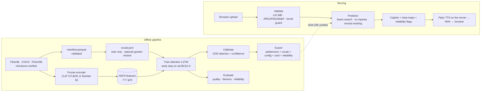

# captioner — Image Caption Generator with Speech Output

Upload a photo, get one English sentence that describes it, and hear it read aloud — privately,
on the server, with no third-party service. A frozen image encoder (**CLIP ViT-B/32** or
**ResNet-50**) feeds an **LSTM decoder with soft attention** ("Show, Attend and Tell"). It trains
on **MS-COCO** for broad coverage, or on **Flickr8k** for the course benchmark. The demo is a
keyboard- and screen-reader-friendly Streamlit app that tells you when it is unsure.

[](https://github.com/Kislay01/DeepLearning_CP/actions/workflows/ci.yml)

> **Status:** code, tests, CI and Docker image are complete. **No model has been trained in this
> repository yet** (it was built without a GPU and without access to pretrained encoder weights),
> so the results tables say *not yet run*. One notebook trains and evaluates it — see
> [Train and evaluate](#train-and-evaluate). Details in [`docs/STATUS.md`](docs/STATUS.md).

## How the original limitations are addressed

| Limitation | What the project does now | Where |
|---|---|---|
| Narrow training data (Flickr8k: mostly people and dogs) misses everything else | Train on **MS-COCO 2014** (123k images, 80 object categories) or COCO + Flickr30k + Flickr8k through one Karpathy-split adapter; the recommended model uses **CLIP** features pre-trained on web-scale image–text data | ADR-023, ADR-024 · `configs/coco_clip.yaml` |
| Captions guess gender or age from appearance | Gender-neutral training targets (`man/woman → person`, `boy/girl → child`, `his/her → their`, …); every served caption is rewritten neutrally whatever the model; evaluation **measures** the model's gender word, error and guess rates | ADR-021 |
| Hallucinated objects and repetitive loops | Decoding blocks repeated trigrams and repeated content words; the taxonomy and `repeated_word_rate` track what remains | ADR-022 |
| Unfamiliar photos still get confident-sounding captions | A calibrated **out-of-domain detector** (k-means over training features, 99th-percentile threshold on validation) and a calibrated confidence threshold ship with each model; the UI warns, and the *spoken* caption is hedged ("Possibly: …"); evaluation checks that flagged captions really score lower | ADR-022 |
| Speech went to Google's unofficial gTTS endpoint | **Local neural TTS (Piper)** by default — pinned, SHA-256-verified voice, runs in-process, works with no network (proved in CI with `--network none`); gTTS is opt-in only and labelled | ADR-020 |

### Deep-learning upgrades beyond the blueprint

| Upgrade | Why it matters | Where |
|---|---|---|
| Model selection on **CIDEr-D** (own implementation, identical to pycocoevalcap) | CIDEr correlates with human judgement far better than BLEU-4 | ADR-025 |
| **Label smoothing**, **AdamW** (decay groups), **cosine schedule with warmup**, **EMA** weights | Standard modern recipe: better-calibrated, less generic captions and smoother optimisation | ADR-025 |
| **Self-critical sequence training** (CIDEr-D reward, leave-one-out baseline) | Removes exposure bias and optimises the metric directly; the largest documented gain for captioners | ADR-026 · `configs/coco_clip_scst.yaml` |
| **Transformer decoder** (M3, pre-norm, tied embeddings, grid encoder) | The modern alternative to the LSTM; shares decoding, heat-maps and serving | ADR-027 · `configs/coco_clip_transformer.yaml` |
| **CLIPScore / RefCLIPScore** | Reference-free check that a caption is true of the image (catches hallucination) | ADR-028 |

Recommended training path: `coco_clip.yaml` (XE) → `coco_clip_scst.yaml` (SCST), with
`coco_clip_transformer.yaml` as the competing decoder.

The original reference defects D1–D12 (no evaluation, "a" deleted, pickles, server-side audio, …)
are fixed too. Each has a named regression test; see [`docs/TRACEABILITY.md`](docs/TRACEABILITY.md).

## Architecture



M2 decoder per step: additive attention over the 7×7 grid → gated context `σ(f_β(h)) ⊙ Σ α_i a_i`
→ `LSTMCell([E(y); z])` → softmax. Loss = cross-entropy (ignoring `<pad>`) + doubly-stochastic
attention regulariser. One preprocessing function (`captioner.data.transforms.load_image`) is
shared by feature extraction, training and serving, with the encoder's own resize/normalisation
profile. Design: [`docs/architecture.md`](docs/architecture.md) (blueprint) plus
[`docs/DECISIONS.md`](docs/DECISIONS.md) (ADR-020 onward supersede the blueprint where they differ).

## Setup

Requires Python 3.11, [uv](https://docs.astral.sh/uv/), and Java 1.8+ for METEOR / the PTB tokenizer.

```bash
git clone https://github.com/Kislay01/DeepLearning_CP.git && cd DeepLearning_CP
make setup          # uv sync --frozen (+ pre-commit hooks)
make lint test      # ruff, mypy --strict, unit tests with coverage
```

## Train and evaluate

Open [`notebooks/colab_train.ipynb`](notebooks/colab_train.ipynb) on Colab or Kaggle with a GPU,
pick a config, and run all cells. Or run locally:

| Config | Data | Encoder | Purpose |
|---|---|---|---|
| `configs/coco_clip.yaml` | MS-COCO 2014 | CLIP ViT-B/32 | **recommended demo model** |
| `configs/coco_attention.yaml` | MS-COCO 2014 | ResNet-50 | COCO baseline |
| `configs/combined_attention.yaml` | COCO + Flickr30k + Flickr8k | ResNet-50 | broadest data (Flickr30k needs its request form) |
| `configs/attention_neutral.yaml` | Flickr8k | ResNet-50 | course benchmark, neutral captions |
| `configs/attention.yaml`, `merge_baseline.yaml`, `attention_finetune.yaml` | Flickr8k | ResNet-50 | blueprint experiments |

```bash
CONFIG=configs/coco_clip.yaml
make data     CONFIG=$CONFIG   # download (checksums verified / recorded) + manifest + vocab
make features CONFIG=$CONFIG   # encoder features → data/features/<dataset>/*.h5
make train    CONFIG=$CONFIG   # train, early-stop, then calibrate reliability
make eval     CONFIG=$CONFIG   # test split, beam 1/3/5 → reports/<run>/
make export   CONFIG=$CONFIG   # artifacts/release/0.1.0/ (+ release.yaml to publish)
```

Override any key: `uv run captioner train -c $CONFIG --set train.epochs=10 --set seed=1`. Runs are
tracked in MLflow (`./mlruns`) and TensorBoard (`artifacts/runs/<run>/tb`).

## Results

Every number must come from a `reports/<run>/metrics.json` produced by `captioner evaluate`.

| Model | Data | Decoding | BLEU-4 | METEOR | CIDEr | gender error rate (model) | flagged CIDEr / unflagged | Source |
|---|---|---|---|---|---|---|---|---|
| M1 merge baseline | Flickr8k | beam 3 | not yet run | not yet run | not yet run | not yet run | not yet run | — |
| M2 attention | Flickr8k | beam 3 | not yet run | not yet run | not yet run | not yet run | not yet run | — |
| M2 attention, neutral | Flickr8k | beam 3 | not yet run | not yet run | not yet run | not yet run | not yet run | — |
| M2 attention, CLIP (recommended) | COCO | beam 3 | not yet run | not yet run | not yet run | not yet run | not yet run | — |

Targets from [`docs/prd.md`](docs/prd.md) §7 (Flickr8k): M2 BLEU-4 ≥ 0.19 and CIDEr ≥ 0.50. Every
experiment and ablation (E1–E8, A1–A3) with its exact command is in
[`reports/README.md`](reports/README.md). **Sample outputs:** not yet run; `make eval` writes
`reports/<run>/samples.html` (random, best and worst captions, attention maps, failure taxonomy).

## Use the model

```bash
uv run captioner predict --image photo.jpg --beam 3              # latest run; prints reliability flags
uv run captioner predict --image photo.jpg --release artifacts/release/0.1.0
make app                                                         # Streamlit on :8501
```

The app looks for a model in this order: `CAPTIONER_RELEASE_DIR`, `CAPTIONER_RUN_DIR`,
`artifacts/release/<version>`, the release pinned in `configs/release.yaml` (downloaded and
SHA-256-verified at start-up), then the newest training run.

**Docker (CPU, non-root, voice baked in):**

```bash
docker build -t captioner .
docker run --rm -p 8501:8501 --read-only --tmpfs /tmp -v captioner-cache:/home/app/.cache \
  -v "$PWD/artifacts/release/0.1.0:/model:ro" -e CAPTIONER_RELEASE_DIR=/model captioner
```

Hugging Face Spaces: see [`deploy/huggingface/README.md`](deploy/huggingface/README.md).

## Project layout

```
configs/      base · attention · merge_baseline · attention_finetune · attention_neutral
              coco_attention · coco_clip · combined_attention · release (pinned model)
src/captioner/
  data/       download (MD5/TOFU, zip-slip guard) · manifest · karpathy (COCO/Flickr30k) · sources
              text · neutral (gender-neutral wording) · vocab · transforms · dataset
  features/   extract (ResNet-50 / CLIP → HDF5)
  models/     encoder (ResNet-50, CLIP) · merge (M1) · attention (M2) · captioner (protocol, loss)
  training/   loop · train · early_stopping · checkpoint · tracking (MLflow + TensorBoard)
  inference/  decode (greedy, beam, repetition blocking) · predictor · reliability · validation
              heatmap · release · service
  evaluation/ metrics · evaluate · calibrate · fairness · taxonomy · report (samples.html)
  tts/        speak (Piper local neural voice; eSpeak; opt-in gTTS)
  cli.py      captioner download | prepare | extract | train | calibrate | evaluate | predict | export
app/          streamlit_app.py · components.py  (+ .streamlit/config.toml design tokens)
tests/        unit · integration · app · fixtures/mini_flickr (20 real images, 381 KiB)
docs/         seven blueprint docs · STATUS · DECISIONS (ADRs) · TRACEABILITY
```

## Testing

```bash
make test                         # unit + app tests, coverage gate 80 %
uv run pytest -m integration      # pipelines (Flickr8k, COCO-format, CLIP), overfit, determinism, real voice
make test-all                     # everything (≈ 3 min on CPU)
```

CI runs lint, unit, integration, security (pip-audit, gitleaks, no-pickle grep) and a Docker
build that checks the non-root user, the health endpoint, and offline speech.

## Remaining limitations

These are honest residuals, not things the code hides:

- Coverage still ends where the training data ends. COCO is far broader than Flickr8k, but rare
  objects, text in images and fine-grained species are often missed. The out-of-domain detector
  flags many such photos; it can't catch every one.
- Hallucinations are reduced, not eliminated: an LSTM captioner can still name an object that
  isn't there. Hedged speech and the calibrated flags tell the listener when to be sceptical.
- Neutral wording removes gender *guesses*. It can't remove every other bias the training
  captions carry (for example scene or activity stereotypes).
- English only. Not a certified assistive device and not for safety-critical use. The checks that
  need a human (screen reader, keyboard-only, 200 % zoom) are listed as pending in `docs/STATUS.md`.

## Data, model and voice licences

- **Code:** MIT ([`LICENSE`](LICENSE)).
- **Images:** Flickr8k / Flickr30k images belong to their Flickr owners; COCO images are under
  their Flickr licences. All are for **non-commercial research and education only**. Datasets
  are downloaded at run time and never stored in this repository. Cite:
  - M. Hodosh, P. Young, J. Hockenmaier (2013). *Framing Image Description as a Ranking Task.* JAIR 47.
  - T.-Y. Lin et al. (2014). *Microsoft COCO: Common Objects in Context.* ECCV.
  - P. Young et al. (2014). *From image descriptions to visual denotations.* TACL 2 (Flickr30k).
  - A. Karpathy, L. Fei-Fei (2015). *Deep Visual-Semantic Alignments for Generating Image Descriptions.* CVPR (splits).
- **Voice:** Piper `en-us lessac medium`, trained on the Blizzard 2013 Lessac data (research licence).

## Credits

Rebuilt from scratch. The original project
[vishwajit2005/DL-CP](https://github.com/vishwajit2005/DL-CP) was used as a reference for the
project's intent only; none of its code, notebooks, pickles, weights or data were copied.
