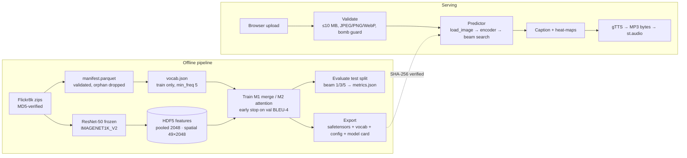

# captioner — Image Caption Generator with Speech Output

Upload a photo, get one English sentence that describes it, and hear it read aloud in your browser.
A frozen **ResNet-50** encoder feeds an **LSTM decoder with soft attention** ("Show, Attend and Tell"),
trained on **Flickr8k**. A merge-LSTM baseline (a bug-fixed version of the original tutorial model)
is included for comparison. The demo is a keyboard- and screen-reader-friendly Streamlit app.

[](https://github.com/Kislay01/DeepLearning_CP/actions/workflows/ci.yml)

> **Status:** code, tests, CI and Docker image are complete. **No model has been trained in this
> repository yet** (it was built without a GPU and without access to the ImageNet weights), so the
> results table below says *not yet run*. One command trains and evaluates it — see
> [Train and evaluate](#train-and-evaluate). Details in [`docs/STATUS.md`](docs/STATUS.md).

## Architecture



M2 decoder per step: additive attention over the 7×7 grid → gated context
`σ(f_β(h)) ⊙ Σ α_i a_i` → `LSTMCell([E(y); z])` → softmax. Loss = cross-entropy (ignoring `<pad>`)
+ doubly-stochastic attention regulariser. One preprocessing function (`captioner.data.transforms.load_image`)
is shared by feature extraction, training and serving. Full design: [`docs/architecture.md`](docs/architecture.md).

## What this fixes in the reference project

The original repo (a Keras tutorial clone) had no evaluation, deleted the word "a", used pickles,
played audio on the server and committed 2.4 GB of data. Each defect D1–D12 from
[`docs/prd.md`](docs/prd.md) §2 has a named regression test (`test_regression_D2_keeps_article_a`, …);
see [`docs/TRACEABILITY.md`](docs/TRACEABILITY.md).

## Setup

Requires Python 3.11, [uv](https://docs.astral.sh/uv/), and Java 1.8+ for METEOR / the PTB tokenizer.

```bash
git clone https://github.com/Kislay01/DeepLearning_CP.git && cd DeepLearning_CP
make setup          # uv sync --frozen (+ pre-commit hooks)
make lint test      # ruff, mypy --strict, unit tests with coverage
```

Optional offline speech: `uv sync --extra offline-tts` (pyttsx3).

## Train and evaluate

```bash
make data     CONFIG=configs/attention.yaml   # download Flickr8k (1.1 GB), verify MD5, manifest + vocab
uv run python scripts/verify_data.py           # 40,000 rows · 6000/1000/1000 · vocab 2,529 + 4
make features CONFIG=configs/attention.yaml   # ResNet-50 features → data/features/*.h5 (~1.6 GB)
make train    CONFIG=configs/attention.yaml   # M2; use configs/merge_baseline.yaml for M1
make eval     CONFIG=configs/attention.yaml   # test split, beam 1/3/5 → reports/<run>/
make export   CONFIG=configs/attention.yaml   # artifacts/release/0.1.0/
```

On Colab or Kaggle (free T4 GPU), open [`notebooks/colab_train.ipynb`](notebooks/colab_train.ipynb):
it clones the repo, runs `uv sync`, then `make data features train eval`.

Any config key can be overridden: `uv run captioner train -c configs/attention.yaml --set train.epochs=10 --set seed=1`.
Runs are tracked in MLflow (`./mlruns`) and TensorBoard (`artifacts/runs/<run>/tb`).

## Results

Flickr8k official test split (1,000 images × 5 references), `pycocoevalcap` metrics. Every number
must come from a `reports/<run>/metrics.json` produced by `captioner evaluate`.

| Model | Decoding | BLEU-1 | BLEU-4 | METEOR | ROUGE-L | CIDEr | Source |
|---|---|---|---|---|---|---|---|
| M1 merge baseline | greedy | not yet run | not yet run | not yet run | not yet run | not yet run | — |
| M1 merge baseline | beam 3 | not yet run | not yet run | not yet run | not yet run | not yet run | — |
| M2 soft attention | greedy | not yet run | not yet run | not yet run | not yet run | not yet run | — |
| M2 soft attention | beam 3 | not yet run | not yet run | not yet run | not yet run | not yet run | — |
| M2 soft attention | beam 5 | not yet run | not yet run | not yet run | not yet run | not yet run | — |

Targets from [`docs/prd.md`](docs/prd.md) §7: M2 BLEU-4 ≥ 0.19 and CIDEr ≥ 0.50. For reference,
Show-Attend-Tell reports BLEU-4 19.5 on Flickr8k. The commands for every experiment and ablation
(E1–E5, A1–A2) are in [`reports/README.md`](reports/README.md).

**Sample outputs:** not yet run. `make eval` writes `reports/<run>/samples.html`, which contains
25 random, 10 best and 10 worst test captions next to their references, plus attention maps,
a failure taxonomy and diversity statistics.

## Use the model

```bash
uv run captioner predict --image photo.jpg --beam 3                         # latest run
uv run captioner predict --image photo.jpg --release artifacts/release/0.1.0
make app                                                                    # Streamlit on :8501
```

The app looks for a model in this order: `CAPTIONER_RELEASE_DIR`, `CAPTIONER_RUN_DIR`,
`artifacts/release/<version>`, the release pinned in `configs/release.yaml` (downloaded and
SHA-256-verified at start-up), then the newest training run.

**Docker (CPU, non-root):**

```bash
docker build -t captioner .
docker run --rm -p 8501:8501 --read-only --tmpfs /tmp -v captioner-cache:/home/app/.cache \
  -v "$PWD/artifacts/release/0.1.0:/model:ro" -e CAPTIONER_RELEASE_DIR=/model captioner
```

Hugging Face Spaces: see [`deploy/huggingface/README.md`](deploy/huggingface/README.md).

## Project layout

```
configs/      base · merge_baseline · attention · attention_finetune · release (pinned model)
src/captioner/
  data/       download (MD5, zip-slip guard) · manifest · text · vocab · transforms · dataset
  features/   extract (ResNet-50 → HDF5)
  models/     encoder · merge (M1) · attention (M2) · captioner (protocol, loss)
  training/   loop · train · early_stopping · checkpoint · tracking (MLflow + TensorBoard)
  inference/  decode (greedy, beam) · predictor · validation · heatmap · release · service
  evaluation/ metrics (pycocoevalcap) · evaluate · report (samples.html) · taxonomy
  tts/        speak (gTTS → bytes, offline fallback)
  cli.py      captioner download | prepare | extract | train | evaluate | predict | export
app/          streamlit_app.py · components.py  (+ .streamlit/config.toml design tokens)
tests/        unit · integration · app · fixtures/mini_flickr (20 real images, 381 KiB)
docs/         prd · architecture · database · code_style · design_system · security · testing
              STATUS · DECISIONS (ADRs) · TRACEABILITY
```

## Testing

```bash
make test                         # unit tests, coverage gate 80 % (currently 93 % unit-only)
uv run pytest -m integration      # pipeline smoke, overfit-one-batch, determinism, round-trips
make test-all                     # everything (≈ 2 min on CPU), 98 % coverage
```

CI runs lint, unit, integration, security (pip-audit, gitleaks, no-pickle grep) and a Docker
build + health check on every push.

## Limitations

- Trained on 8,000 Flickr photos dominated by people and dogs in Western outdoor scenes; other
  content is often described generically or wrongly.
- Captions can assume gender or age from appearance and can hallucinate objects, colours and counts.
- English only. The online voice (gTTS) uses Google's unofficial endpoint and receives the caption
  text (never the image); if it fails, the app shows the caption without audio.
- Not a certified assistive device and not for safety-critical use. The accessibility checks that
  need a human (screen reader, keyboard-only, 200 % zoom) are listed as pending in `docs/STATUS.md`.

## Dataset citation and licence

- **Code:** MIT ([`LICENSE`](LICENSE)).
- **Data:** Flickr8k images belong to their Flickr owners and are provided for **non-commercial
  research and educational use only**. The dataset is downloaded at run time and is never stored
  in this repository. Cite:

  > M. Hodosh, P. Young and J. Hockenmaier (2013). *Framing Image Description as a Ranking Task:
  > Data, Models and Evaluation Metrics.* Journal of Artificial Intelligence Research 47, 853–899.

## Credits

Rebuilt from scratch. The original project
[vishwajit2005/DL-CP](https://github.com/vishwajit2005/DL-CP) was used as a reference for the
project's intent only; none of its code, notebooks, pickles, weights or data were copied.
